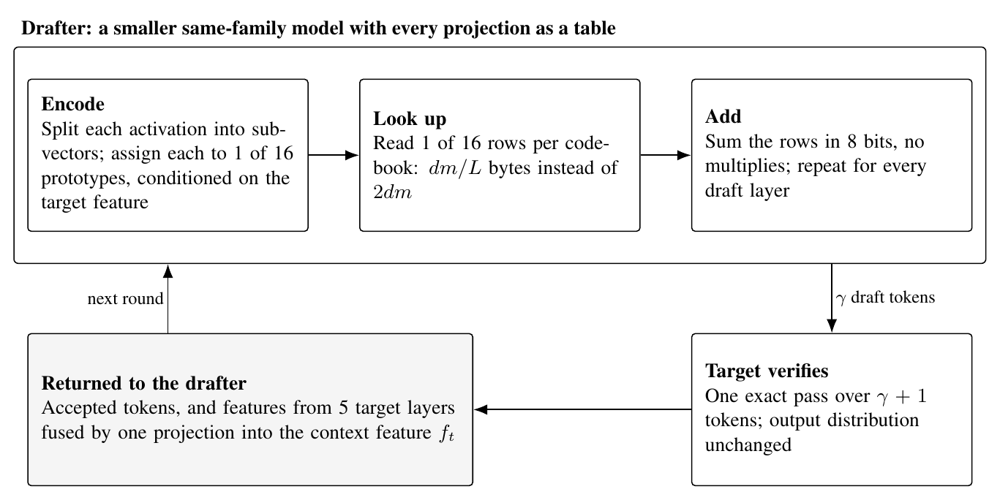

# Multiplication-Free Drafting for Speculative Decoding

CS 2420 Group 2 · Juliana Li, Eric Xu, Bowen Yang, Adam Zhou · October 2026 · condensed version of [PROPOSAL.md](PROPOSAL.md)

## Summary

Speculative decoding speeds up a large language model by having a cheap drafter guess several tokens that the large model then checks in one pass. We propose a drafter whose linear layers do no multiplication at all: each layer is replaced by a precomputed lookup table, following the MADDNESS method of [Blalock and Guttag (2021)](https://arxiv.org/abs/2106.10860). The drafter is a smaller model from the same family as the target, for example Llama-3.2-1B drafting for Llama-3.1-8B, and at batch size 1 it reads 1/16 of the bytes of the same model in 16 bits. The one data-dependent step in a lookup drafter is choosing which table row to read. Our main claim is that choosing that row with help from the target model's own features, which are free after every verification, raises the fraction of accepted draft tokens compared with a plain hash at the same table size. The target still verifies every token, so output quality is unchanged.

## Motivation

1. **Draft cost matters more than draft quality.** With acceptance rate α, γ drafted tokens per round and drafter cost c per token (as a fraction of one target forward pass), the speedup is (1 − α^(γ+1)) / ((1 − α)(γc + 1)). Two measurement studies find that c decides: [Ha et al. (ICML 2026)](https://www.eecg.utoronto.ca/~ganesa10/assets/pdfs/selfspecdecode-icml2026.pdf) state "Draft cost, not acceptance rate, dominates throughput", and [Yan et al. (NAACL 2025)](https://arxiv.org/abs/2402.01528) find that a drafter's language-modeling quality "does not correlate strongly" with its speedup.
2. **Current drafters still multiply.** Self-drafters skip layers ([Draft & Verify](https://aclanthology.org/2024.acl-long.607), [LayerSkip](https://aclanthology.org/2024.acl-long.681), [Kangaroo](https://arxiv.org/abs/2404.18911)), quantized drafters run at 4 bits ([QSpec](https://arxiv.org/abs/2410.11305), [QuantSpec](https://arxiv.org/abs/2502.10424)), and trained drafters ([EAGLE-3](https://arxiv.org/abs/2503.01840), [DFlash](https://arxiv.org/abs/2602.06036)) run a new small network. All of them still run dense matrix products.
3. **Lookup tables remove the multiplication, and the drafter is the one place where their error is affordable.** MADDNESS replaces a matrix product with table lookups and 8-bit additions, up to 100× faster than exact products on CPU, but its error compounds through depth, and [McCarter and Dronen (2022)](https://arxiv.org/abs/2207.05808) found whole-network accuracy "substantially diminished". In a drafter, approximation error only lowers α, and by point 1 that is the cheap currency.
4. **The target's features are the best guide to the next token.** EAGLE-3 and DFlash reach 6× by feeding the target's features into the drafter; DFlash summarizes this as "the target knows best". We use the same signal for the one decision a lookup drafter makes per layer: which table row to read.

## Related work

- **Speculative decoding.** [Leviathan et al. (2023)](https://arxiv.org/abs/2211.17192) and [Chen et al. (2023)](https://arxiv.org/abs/2302.01318) introduced the draft-then-verify loop with a rejection rule that preserves the target's output distribution.
- **Feature-fed drafters.** EAGLE feeds the target's second-to-top feature into a trained draft layer; EAGLE-3 fuses a low, middle and high target layer; DFlash fuses five uniformly spaced target layers through one projection and injects the result into every draft layer. These papers already found which target layers carry information about future tokens, and we reuse their choices.
- **Lookup-based matrix products.** MADDNESS splits each input row into short subvectors, assigns each to one of 16 learned prototypes with a four-level decision tree, and sums precomputed 8-bit table entries. [LUT-NN](https://arxiv.org/abs/2302.03213) and [Stella Nera](https://arxiv.org/abs/2311.10207) made the prototypes trainable and built hardware for it. The LUT kernels now used for LLMs ([LUT-GEMM](https://arxiv.org/abs/2206.09557), [T-MAC](https://arxiv.org/abs/2407.00088), [FLUTE](https://aclanthology.org/2024.findings-emnlp.724)) are a different object: they index tables by weight bit patterns and are exact for a quantized weight. We found no application of activation-indexed tables to a decoder language model of 1B parameters or more, and none to drafting.

## Proposed method

1. **Model pair.** Llama-3.2-1B drafts for Llama-3.1-8B. They share the tokenizer, which speculative decoding requires, and the architecture family, which keeps the feature adapter small. Secondary pairs: Llama-3.2-3B for 8B, Qwen3-0.6B for Qwen3-8B.
2. **Build the tables (offline).** For each linear layer with weight W of shape d × m, split the input dimension into C = d/L subvectors of length L (default L = 8). From about 100K activation rows of the drafter on generic text, fit 16 prototypes per subspace. Table entry T_c[k, j] stores the dot product of prototype k in subspace c with the matching slice of column j of W, scaled to 8 bits. After the prototypes are fixed, refit the entries by ridge regression against the layer's exact outputs.
3. **Draft forward pass.** Per token and layer, assign each of the C subvectors to a prototype, then for each of the m outputs add C 8-bit table entries. All attention and MLP projections go through tables. Attention scores, softmax, normalization, activation functions and residual additions stay exact in 16 bits. The drafter proposes γ tokens, the target checks them in one pass, and the rejection rule of Leviathan et al. keeps the output distribution exactly the target's.
4. **Naive row choice (the baselines).** Three encoders that look only at the drafter's own activation: a random-hyperplane hash to 4 bits (the locality-sensitive hashing of the lecture framing), the MADDNESS decision tree (four scalar comparisons), and exact nearest-prototype search (16·L multiplies, the accuracy ceiling for a fixed codebook). All cost under 1% of the exact layer. They differ in accuracy, measured as acceptance rate.
5. **Target-guided row choice (the contribution).** After verification, features from five target layers, spaced uniformly through the depth as in DFlash, are concatenated and projected by one matrix W_c (2048 × 20480 for this pair, about 42M multiply-adds) into a context feature f_t at the last accepted position. This runs once per round, not per draft token. Two ways to use f_t, neither of which changes the bytes read per token:
    - *Guided assignment.* A small per-layer adapter maps f_t to a 32-dimensional context vector. A scorer picks the prototype for each subvector from the subvector plus that context vector. Cost is about 1% of the exact layer, and the scorer can later be distilled into a tree or hash.
    - *Guided codebooks.* Each subspace holds 4 codebooks of 16 prototypes; a 2-bit hash of f_t picks the codebook and the subvector picks the prototype. Storage grows 4×, bytes read per token do not.
6. **Per-layer table budget.** The subvector length L can differ by layer and projection under a total byte budget. This is a tuning knob, not a claimed contribution.
7. **What is not changed.** No target weight is modified, no new transformer is trained, and the output distribution is the target's. The trained parts are the prototypes, tables, fusion projection and small adapters, a few tens of megabytes trained on a calibration set.

## Novelty

- **Using the target model's own features to pick which table row the drafter reads.** The target computes features while checking the previous draft, and those states already encode several upcoming tokens. Existing methods spend a trained network on that signal; we use it to make a cheap choice among 16 precomputed rows. As far as we can find, nobody has used a verifier's features to steer a product-quantization encoder, or compared that against plain hashing on acceptance rate.
- **Cutting draft cost by replacing the drafter's multiplications with table lookups.** Every existing drafter saves cost by running fewer layers, fewer bits, or a smaller dense network. Ours changes the arithmetic itself: its projections do no multiply-adds and read 1/16 of the bytes. This is the first lookup-table drafter.
- **Making an approximation that failed for exact inference affordable.** Whole-network lookup inference loses too much accuracy. Speculative verification turns that accuracy loss into a lower acceptance rate with no change to outputs, and the measurements of Ha et al. and Yan et al. say that is the cheaper price to pay. No one has made or tested this argument.

A consequence rather than a claim: tables and codes are what lookup accelerators (Stella Nera) and CPU lookup kernels (T-MAC) already execute, and Gemma 4 ships a 76M to 500M parameter drafter for on-device use, so a working lookup drafter has a path onto phones that bit-quantized drafters do not.

## Feasibility

Decoding at batch size 1 is bound by memory bandwidth, so cost tracks bytes read, down to a floor set by kernel launch latency. Per token, a 16-bit projection reads 2dm bytes; its table reads one row per codebook, dm/L bytes, which is 1/16 at L = 8. For the primary pair:

| Drafter | Bytes read per drafted token | c by bytes | c expected on an H100 |
| --- | --- | --- | --- |
| Llama-3.2-1B, 16-bit | 2.5 GB | 0.16 | 0.15 to 0.3 |
| Llama-3.2-1B, 4-bit weights | 0.6 GB | 0.04 | 0.1 to 0.2 |
| Llama-3.2-1B, tables at L = 8 | 0.4 GB | 0.02 | 0.1 to 0.2 |

The last column is the honest one: a 16-layer pass at batch 1 is a few hundred kernel launches, about 1 ms on an H100 against about 10 ms for the 8B target, so c has a floor near 0.1 that tables cannot lower. On a GPU the tables buy a modest latency gain over a 4-bit drafter and a large gain in bytes and energy; on bandwidth-bound hardware such as phones the byte reduction is the latency gain. This is why the main claim is the acceptance-rate gain at a fixed table budget, which holds on any hardware. With γ = 5, c = 0.1 gives 1.6× at α = 0.6 and 2.0× at α = 0.7; we expect the 16-bit 1B drafter to reach α of 0.6 to 0.7, which is the ceiling for the lookup drafter.

**Batch size.** A dense weight matrix is read once per batch, but a table is read one row per codebook per token, so by a batch of 16 nearly the whole table has been read. Total bytes per projection per batch, as a fraction of the 16-bit weight matrix:

| Batch size | 16-bit | 4-bit | Tables, L = 8 | Tables, L = 16 | Tables, L = 32 |
| --- | --- | --- | --- | --- | --- |
| 1 | 1 | 0.25 | 0.06 | 0.03 | 0.02 |
| 4 | 1 | 0.25 | 0.25 | 0.13 | 0.06 |
| 16 or more | 1 | 0.25 | 1 | 0.5 | 0.25 |

The byte advantage over a 4-bit drafter holds up to batch 4 at L = 8 and batch 16 at L = 32, which covers interactive serving and on-device decoding. At larger batches the table drafter is bound by its 8-bit additions, which do not run on tensor cores, so a quantized tensor-core drafter is expected to be faster there; this is measured, not claimed. The acceptance-rate claim does not depend on batch size.

Risks: the encoder must be fused into each projection's gather-and-add kernel or it becomes hundreds of dependent launches; LLM activation outliers can waste the 16 prototypes, so per-channel scaling as in [SmoothQuant](https://arxiv.org/abs/2211.10438) is folded into the weights before the tables are built; and the fusion projection W_c must stay out of the per-draft-token path.

## Starter experiments

The first three run on one 80 GB GPU and decide whether the project continues. Every result reports c, α and tokens per second together, as Ha et al. recommend.

1. **Single-layer reconstruction.** Replace one MLP and one attention projection of Llama-3.2-1B with tables at L of 8, 16 and 32, with and without outlier scaling. Measure output error and the KL divergence of the drafter's next-token distribution against 8-bit and 4-bit weight quantization of the same layer. Gate: at L = 8 the KL cost is within 2× that of 4-bit weights.
2. **Acceptance under naive row choice.** Replace every projection and measure α with γ = 5 against Llama-3.1-8B for the hash, tree and nearest-prototype encoders, plus the 16-bit and 4-bit 1B drafters as the ceiling. Gate: the tree encoder at L = 8 lands within 0.1 of the ceiling.
3. **Target-guided row choice.** Train the fusion projection, adapters and scorers, then the guided-codebook variant. Measure α at L of 8, 16 and 32 against the naive encoders at the same L. This is the main result. Gate: a gain of 0.05 in α at L = 8, or matching α at L = 16.
4. **Fused kernel (in parallel with 2 and 3).** One Triton kernel per projection that encodes, gathers and adds in 8 bits; time it against a BF16 matrix-vector product and a 4-bit kernel. Gate: at or below the 4-bit kernel at L = 8.
5. **End-to-end speedup.** Drafter and target in one loop with CUDA graphs, against vanilla decoding, the 16-bit and 4-bit 1B drafters, Draft & Verify and LayerSkip.
6. **Which target features.** Repeat experiment 3 with EAGLE's one layer, EAGLE-3's three and DFlash's five.
7. **Table fine-tuning (if needed).** Fine-tune tables, prototypes and scorers through a straight-through estimator against the target's next-token distribution.

## Open questions

- **Adapter design.** Which target layers and positions feed it, whether the context vector enters the scorer or picks the codebook, and whether to train against the exact encoder's codes or against the target's next-token distribution.
- **Staleness.** f_t is computed at the last verified position; for later draft positions it is either held fixed or recomputed from the drafter's own noisy top-layer feature. Both are tested.
- **Why same family.** Whether the drafter needs the target's family only for the tokenizer and dimensions, or because aligned representations keep the adapter small.
- **Fair hash baseline.** A single 4-bit random hash may assign poorly in an 8-dimensional subspace; if so the baseline gets enough hash tables to match the tree encoder's accuracy.
- **Fusing the encoder on a GPU.** A decision tree inside a kernel causes warp divergence; the branch-free scorer may be the faster encoder on a GPU despite its multiplies.
- **Verification setting.** Greedy and sampled verification, and 16-bit versus 4-bit targets, are all measured.

Logistics for the TF: available GPUs and hours; whether a PyTorch simulation plus a kernel microbenchmark is an acceptable deliverable if the end-to-end loop slips; and whether he knows a usable GPU implementation of MADDNESS or prior work on activation-side product quantization for transformers.

## References

See the reference list in [PROPOSAL.md](PROPOSAL.md); every entry there was checked against its arXiv or venue page on 2026-10-26 or 2026-10-27. Works cited here: Blalock and Guttag 2021 (MADDNESS); Chen et al. 2023; Chen, Liang and Liu 2026 (DFlash); Elhoushi et al. 2024 (LayerSkip); Guo et al. 2024 (FLUTE); Ha et al. 2026; Kung 2026 (CS 2420 lecture notes); Leviathan et al. 2023; Li et al. 2024 (EAGLE); Li et al. 2025 (EAGLE-3); Liu et al. 2024 (Kangaroo); McCarter and Dronen 2022; Park et al. 2024 (LUT-GEMM); Schönleber et al. 2023 (Stella Nera); Tang et al. 2023 (LUT-NN); Tiwari et al. 2025 (QuantSpec); Wei et al. 2024 (T-MAC); Xiao et al. 2023 (SmoothQuant); Yan et al. 2025; Zhang et al. 2024 (Draft & Verify); Zhao et al. 2025 (QSpec).
